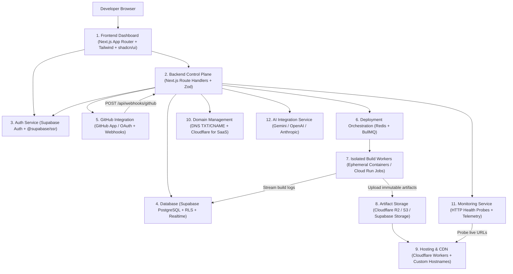

# QuantumHost — System Architecture

## 1. Architectural Principles

QuantumHost is a cloud hosting and deployment platform designed around strict trust-boundary separation:

1. **Control Plane vs. Execution Plane Separation**: The Next.js control plane never clones untrusted repositories, runs `npm install`, or executes user build scripts. All untrusted workloads are dispatched asynchronously via Redis + BullMQ to isolated ephemeral build workers.
2. **Defense-in-Depth Multi-Tenancy**: Every tenant-owned record in Supabase PostgreSQL enforces `user_id` ownership via Row Level Security (RLS), backed by server-verified `auth.getUser()` calls.
3. **Immutable Deployments & Atomic Promotion**: Each build produces an immutable versioned artifact in object storage keyed by `<project_id>/<deployment_id>`. Production routing switches atomically by updating `active_deployment_id`, enabling instant rollbacks.
4. **Provider-Independent Abstractions**: Object storage, hosting/CDN routing, build isolation, and AI diagnostics sit behind clean TypeScript interfaces so infrastructure providers can evolve without rewriting control-plane business logic.

---

## 2. High-Level Architecture Diagram

---

## 3. Component Breakdown (12 Separated Subsystems)

### 1. Frontend Dashboard
- **Technology**: Next.js (App Router), React, TypeScript, Tailwind CSS, shadcn/ui, Lucide icons.
- **Responsibilities**: Authentication UI, repository import wizard, build configuration forms, live deployment log viewer (Supabase Realtime + polling fallback), deployment history & rollback triggers, custom domain DNS wizard, uptime charts, resource usage dashboards, and AI failure diagnosis view.
- **Boundary**: Holds only `NEXT_PUBLIC_SUPABASE_URL` and `NEXT_PUBLIC_SUPABASE_PUBLISHABLE_KEY`. Never accesses `SUPABASE_SERVICE_ROLE_KEY`, decrypted secrets, or build infrastructure credentials.

### 2. Backend Control Plane
- **Technology**: Node.js + Next.js Server Route Handlers (`/api/*`) with strict `zod` schema validation.
- **Responsibilities**: Authenticates every request server-side (`supabase.auth.getUser()`), enforces resource ownership, encrypts/decrypts secrets via AES-256-GCM, validates incoming GitHub webhook signatures, creates deployment records, enqueues BullMQ jobs, and proxies non-secret telemetry queries.
- **Invariant**: Never spawns `git clone`, `npm install`, or user-supplied build commands.

### 3. Authentication Service
- **Technology**: Supabase Auth + `@supabase/ssr` + Next.js `proxy.ts`.
- **Responsibilities**: Email/password registration and login, GitHub OAuth sign-in, PKCE callback exchange (`/auth/callback`), cookie-based SSR session management, and edge token refresh via `supabase.auth.getClaims()`.

### 4. Database
- **Technology**: Supabase PostgreSQL 17 with Row Level Security (RLS), triggers, and Supabase Realtime.
- **Responsibilities**: Stores tenant profiles, encrypted GitHub connections, project build configurations, encrypted environment variables, deployment metadata, streamed build logs, custom domain verification records, health check logs, resource usage metrics, and AI analyses.

### 5. GitHub Integration
- **Technology**: GitHub Apps (`RS256` JWT + installation access tokens), GitHub OAuth, and GitHub REST API (`2022-11-28`).
- **Responsibilities**: Enumerates authorized repositories and branches, inspects `package.json` for framework auto-detection, registers push webhooks, and verifies `X-Hub-Signature-256` HMAC-SHA256 payloads.

### 6. Deployment Orchestration
- **Technology**: Redis + BullMQ (`quantumhost-builds` queue).
- **Responsibilities**: Decouples webhook ingestion and manual deploy requests from build execution, tracks job IDs, manages retry/backoff/concurrency policies, and prevents build spikes from starving the web control plane.

### 7. Build Worker Infrastructure
- **Technology**: Standalone Node.js BullMQ Worker orchestrating ephemeral isolated build environments (Docker containers locally/self-hosted or Google Cloud Run Jobs in managed cloud).
- **Responsibilities**: Checks out target branch/commit using short-lived installation tokens, injects only decrypted project environment variables (stripping all QuantumHost platform secrets), enforces CPU/memory/timeout caps, streams logs to `build_logs`, and uploads output artifacts.

### 8. Artifact Storage
- **Technology**: S3-compatible Object Storage (**Cloudflare R2** primary, with **Supabase Storage** and local object store adapters).
- **Responsibilities**: Stores immutable static build outputs under `<project_id>/<deployment_id>/` along with a content-type manifest. Zero egress fees on Cloudflare R2 keep static delivery costs predictable.

### 9. Hosting & CDN
- **Technology**: **Cloudflare Workers Static Assets / R2 Edge Proxy** (with Cloudflare Pages Direct Upload / Next.js proxy route for local development).
- **Responsibilities**: Serves live production sites (`https://<slug>.<platform-domain>` or `/sites/<slug>`), immutable per-deployment preview URLs (`/d/<deployment_id>`), and verified custom domains from the edge with automatic `Cache-Control` headers.

### 10. Domain Management
- **Technology**: Node.js `node:dns/promises` verifier + **Cloudflare for SaaS (Custom Hostnames API)**.
- **Responsibilities**: Generates unique TXT ownership tokens and CNAME targets, executes live DNS verification checks, provisions automated TLS certificates via Cloudflare Custom Hostnames, and maps verified domains to project routing tables.

### 11. Monitoring Service
- **Technology**: Scheduled/on-demand HTTP availability prober + PostgreSQL `health_checks` & `usage_metrics`.
- **Responsibilities**: Probes active deployment URLs, records HTTP status codes and round-trip latency, computes availability percentages, and aggregates build seconds, storage bytes, bandwidth, request counts, and AI token consumption.

### 12. AI Integration Service
- **Technology**: Provider-independent TypeScript adapter (`AiDiagnosticProvider`) supporting **Google Gemini** (default free-tier capable), **OpenAI**, **Anthropic Claude**, and custom OpenAI-compatible endpoints.
- **Responsibilities**: Analyzes failed build logs and project configurations to generate structured root-cause diagnoses, confidence levels, and remediation steps stored in `ai_analyses`.
