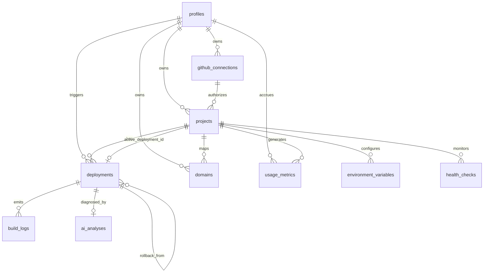

# QuantumHost — Database Design (Supabase PostgreSQL 17)

## 1. Entity-Relationship Diagram

---

## 2. Schema Specification (10 Core Tables)

> **Migration Note**: An initial schema migration (`initial_schema` & `security_hardening_and_storage`) was provisioned on the connected Supabase project `ufmfbsrthpjahrnawirg` during exploratory setup. During Phase 2 reconciliation, table/column names will be aligned cleanly without duplicate tables.

### 1. `profiles`
- `id uuid PRIMARY KEY REFERENCES auth.users(id) ON DELETE CASCADE`
- `email text`
- `full_name text`
- `avatar_url text`
- `plan text NOT NULL DEFAULT 'developer'` (`developer`, `pro`, `enterprise`)
- `created_at timestamptz NOT NULL DEFAULT now()`
- `updated_at timestamptz NOT NULL DEFAULT now()`
- **Trigger**: `handle_new_user()` (`SECURITY DEFINER`, `EXECUTE` revoked from `PUBLIC/anon/authenticated`) inserts profile automatically on `auth.users` insert.

### 2. `github_connections`
- `id uuid PRIMARY KEY DEFAULT gen_random_uuid()`
- `user_id uuid NOT NULL REFERENCES public.profiles(id) ON DELETE CASCADE`
- `provider_type text NOT NULL CHECK (provider_type IN ('github_app', 'oauth', 'pat'))`
- `github_user_id bigint`
- `github_login text NOT NULL`
- `installation_id bigint`
- `encrypted_access_token text` (AES-256-GCM ciphertext; never exposed via client responses)
- `token_expires_at timestamptz`
- `scopes text[] NOT NULL DEFAULT '{}'`
- `created_at`, `updated_at timestamptz`
- **Indexes**: `(user_id)`, `UNIQUE (user_id, github_login, provider_type)`.

### 3. `projects`
- `id uuid PRIMARY KEY DEFAULT gen_random_uuid()`
- `user_id uuid NOT NULL REFERENCES public.profiles(id) ON DELETE CASCADE`
- `github_connection_id uuid REFERENCES public.github_connections(id) ON DELETE SET NULL`
- `name text NOT NULL`
- `slug text NOT NULL UNIQUE` (DNS-safe lowercase slug)
- `framework text NOT NULL DEFAULT 'static'`
- `repo_full_name text`, `repo_id bigint`, `repo_url text`
- `default_branch text NOT NULL DEFAULT 'main'`
- `root_directory text NOT NULL DEFAULT '.'`
- `install_command text NOT NULL DEFAULT 'npm ci'`
- `build_command text NOT NULL DEFAULT 'npm run build'`
- `output_directory text NOT NULL DEFAULT 'dist'`
- `node_version text NOT NULL DEFAULT '20'`
- `auto_deploy boolean NOT NULL DEFAULT true`
- `webhook_id bigint`, `webhook_secret_encrypted text`
- `active_deployment_id uuid REFERENCES public.deployments(id) ON DELETE SET NULL`
- `created_at`, `updated_at timestamptz`
- **Indexes**: `(user_id)`, `(github_connection_id)`, `(active_deployment_id)`, `(repo_full_name)`.

### 4. `deployments`
- `id uuid PRIMARY KEY DEFAULT gen_random_uuid()`
- `project_id uuid NOT NULL REFERENCES public.projects(id) ON DELETE CASCADE`
- `user_id uuid NOT NULL REFERENCES public.profiles(id) ON DELETE CASCADE`
- `deployment_number integer NOT NULL` (auto-assigned monotonically per `project_id` with advisory lock)
- `status text NOT NULL DEFAULT 'queued'` (`queued`, `building`, `uploading`, `ready`, `failed`, `cancelled`)
- `environment text NOT NULL DEFAULT 'production'` (`production`, `preview`)
- `trigger_source text NOT NULL DEFAULT 'manual'` (`manual`, `git_push`, `rollback`, `api`)
- `git_branch`, `git_commit_sha`, `git_commit_message`, `git_author text`
- `job_id text` (BullMQ job ID)
- `artifact_storage_provider text` (`r2`, `s3`, `supabase`, `local`)
- `artifact_key text`
- `artifact_size_bytes bigint NOT NULL DEFAULT 0`
- `preview_url text`
- `build_duration_ms integer`
- `error_summary text`
- `rollback_from_deployment_id uuid REFERENCES public.deployments(id) ON DELETE SET NULL`
- `started_at`, `finished_at`, `created_at`, `updated_at timestamptz`
- **Indexes**: `UNIQUE (project_id, deployment_number)`, `(project_id, created_at DESC)`, `(user_id)`, `(status)`.

### 5. `build_logs`
- `id bigint GENERATED ALWAYS AS IDENTITY PRIMARY KEY`
- `deployment_id uuid NOT NULL REFERENCES public.deployments(id) ON DELETE CASCADE`
- `project_id uuid NOT NULL REFERENCES public.projects(id) ON DELETE CASCADE`
- `user_id uuid NOT NULL REFERENCES public.profiles(id) ON DELETE CASCADE`
- `seq integer NOT NULL`
- `level text NOT NULL DEFAULT 'info'` (`info`, `warn`, `error`, `debug`, `system`)
- `stage text NOT NULL DEFAULT 'build'` (`queue`, `clone`, `install`, `build`, `upload`, `deploy`, `system`)
- `message text NOT NULL`
- `created_at timestamptz NOT NULL DEFAULT now()`
- **Indexes**: `(deployment_id, seq ASC)`, `(project_id)`, `(user_id)`.
- **Realtime**: Published to `supabase_realtime` for live terminal streaming.

### 6. `environment_variables`
- `id uuid PRIMARY KEY DEFAULT gen_random_uuid()`
- `project_id uuid NOT NULL REFERENCES public.projects(id) ON DELETE CASCADE`
- `user_id uuid NOT NULL REFERENCES public.profiles(id) ON DELETE CASCADE`
- `key text NOT NULL`
- `encrypted_value text NOT NULL` (AES-256-GCM ciphertext)
- `is_secret boolean NOT NULL DEFAULT true`
- `environment text NOT NULL DEFAULT 'production'` (`production`, `preview`, `all`)
- `created_at`, `updated_at timestamptz`
- **Indexes**: `UNIQUE (project_id, key, environment)`, `(project_id)`, `(user_id)`.

### 7. `domains`
- `id uuid PRIMARY KEY DEFAULT gen_random_uuid()`
- `project_id uuid NOT NULL REFERENCES public.projects(id) ON DELETE CASCADE`
- `user_id uuid NOT NULL REFERENCES public.profiles(id) ON DELETE CASCADE`
- `domain text NOT NULL UNIQUE`
- `verification_token text NOT NULL`
- `verification_status text NOT NULL DEFAULT 'pending'` (`pending`, `verified`, `failed`)
- `ssl_status text NOT NULL DEFAULT 'pending'` (`pending`, `provisioning`, `active`, `error`)
- `cloudflare_hostname_id text` (for Cloudflare for SaaS custom hostname tracking)
- `dns_records jsonb NOT NULL DEFAULT '[]'::jsonb`
- `last_checked_at`, `verified_at`, `created_at`, `updated_at timestamptz`
- **Indexes**: `(project_id)`, `(user_id)`.

### 8. `health_checks`
- `id bigint GENERATED ALWAYS AS IDENTITY PRIMARY KEY`
- `project_id uuid NOT NULL REFERENCES public.projects(id) ON DELETE CASCADE`
- `user_id uuid NOT NULL REFERENCES public.profiles(id) ON DELETE CASCADE`
- `target_url text NOT NULL`
- `status text NOT NULL CHECK (status IN ('up', 'degraded', 'down'))`
- `http_status integer`
- `latency_ms integer`
- `error_message text`
- `checked_at timestamptz NOT NULL DEFAULT now()`
- **Indexes**: `(project_id, checked_at DESC)`, `(user_id)`.

### 9. `usage_metrics`
- `id bigint GENERATED ALWAYS AS IDENTITY PRIMARY KEY`
- `user_id uuid NOT NULL REFERENCES public.profiles(id) ON DELETE CASCADE`
- `project_id uuid REFERENCES public.projects(id) ON DELETE CASCADE`
- `deployment_id uuid REFERENCES public.deployments(id) ON DELETE SET NULL`
- `metric_type text NOT NULL CHECK (metric_type IN ('build_seconds', 'storage_bytes', 'bandwidth_bytes', 'http_request', 'ai_tokens'))`
- `value numeric NOT NULL`
- `metadata jsonb NOT NULL DEFAULT '{}'::jsonb`
- `recorded_at timestamptz NOT NULL DEFAULT now()`
- **Indexes**: `(user_id, recorded_at DESC)`, `(project_id, recorded_at DESC)`, `(deployment_id)`.

### 10. `ai_analyses`
- `id uuid PRIMARY KEY DEFAULT gen_random_uuid()`
- `deployment_id uuid NOT NULL UNIQUE REFERENCES public.deployments(id) ON DELETE CASCADE`
- `project_id uuid NOT NULL REFERENCES public.projects(id) ON DELETE CASCADE`
- `user_id uuid NOT NULL REFERENCES public.profiles(id) ON DELETE CASCADE`
- `provider text NOT NULL` (`gemini`, `openai`, `anthropic`, `openai_compatible`)
- `model text NOT NULL`
- `summary text NOT NULL`
- `root_cause text NOT NULL`
- `suggested_fixes jsonb NOT NULL DEFAULT '[]'::jsonb`
- `confidence text NOT NULL CHECK (confidence IN ('high', 'medium', 'low'))`
- `tokens_used integer NOT NULL DEFAULT 0`
- `created_at timestamptz NOT NULL DEFAULT now()`
- **Indexes**: `(project_id)`, `(user_id)`.

*(Supporting tables: `uptime_monitors` for per-project probe intervals/toggles, `ai_configurations` for encrypted per-user AI keys, and `published_routes` for zero-secret public edge routing.)*

---

## 3. Ownership & Security Requirements

1. **Row Level Security (RLS) Enabled Everywhere**: All tables in `public` enable RLS with no exceptions.
2. **Performance-Optimized Policies**: Every policy wraps `auth.uid()` inside `(select auth.uid()) = user_id` and targets `TO authenticated` (never deprecated `auth.role()`).
3. **Write-Protection on `UPDATE`**: All `UPDATE` policies specify both `USING ((select auth.uid()) = user_id)` and `WITH CHECK ((select auth.uid()) = user_id)` to prevent cross-tenant row reassignment.
4. **Zero Client-Side Service Key**: `SUPABASE_SERVICE_ROLE_KEY` is restricted exclusively to backend webhook handlers and the build worker.
5. **Security Advisor Gate**: `supabase db advisors` / MCP `get_advisors` must report zero security warnings after every migration.
