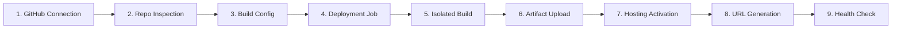

# QuantumHost — Deployment Lifecycle

## 1. End-to-End Workflow

### Stage-by-Stage Specification

1. **GitHub Repository Connection**:
   - Developer installs the QuantumHost GitHub App (or authorizes OAuth/PAT).
   - Control plane verifies credentials against `GET /user` or mints an installation token, encrypts the credential with AES-256-GCM, and saves it in `github_connections`.

2. **Repository Inspection**:
   - Control plane queries `GET /repos/{owner}/{repo}/branches` and `GET /repos/{owner}/{repo}/contents/package.json` (scoped to `root_directory`).
   - Detects framework (`nextjs`, `vite`, `react`, `astro`, `static`, `node`) and suggests default `install_command`, `build_command`, and `output_directory`.

3. **Build Configuration**:
   - Developer confirms project `slug`, production `default_branch`, Node version, build commands, auto-deploy flag, and encrypted `environment_variables`.
   - If auto-deploy is enabled, control plane registers a GitHub `push` webhook with a per-project random secret.

4. **Deployment Job Creation**:
   - Triggered manually (`POST /api/deployments`) or automatically via `POST /api/webhooks/github` (after verifying `X-Hub-Signature-256`).
   - Inserts a `deployments` row with `status = 'queued'` and an atomic monotonic `deployment_number`.
   - Enqueues `{ deploymentId, projectId, userId, environment }` to Redis/BullMQ. If Redis is unreachable, marks the deployment `failed` immediately and returns `503` (never leaves phantom `queued` jobs).

5. **Isolated Build Execution**:
   - Separate BullMQ worker pulls the job and creates an isolated workspace (`/tmp/qh-builds/<deploymentId>` or ephemeral Docker container).
   - Mints a short-lived GitHub installation token (or decrypts OAuth/PAT) solely for `git clone --depth 1` and immediately strips the token from logs.
   - Constructs a sanitized environment containing **only** minimal OS variables (`PATH`, `NODE_ENV`, `CI=true`) plus the project's decrypted `environment_variables` — never platform secrets.
   - Runs `install_command` and `build_command` under strict timeout (`BUILD_TIMEOUT_MS`) and output limits.
   - Streams timestamped, secret-redacted log lines to `build_logs`.

6. **Artifact Upload**:
   - Transitions deployment `status = 'uploading'`.
   - Walks `output_directory` (verifying no path traversal outside the workspace), enforces `BUILD_MAX_OUTPUT_BYTES`, generates `__qh_manifest.json` with MIME types, and uploads immutable files to Object Storage under `<project_id>/<deployment_id>/`.

7. **Hosting Activation**:
   - Transitions deployment `status = 'ready'`, storing `artifact_storage_provider`, `artifact_key`, `artifact_size_bytes`, and `build_duration_ms`.
   - For `production` deployments, atomically updates `projects.active_deployment_id = deployment.id` (which syncs `published_routes` via PostgreSQL trigger).
   - Records `build_seconds` and `storage_bytes` in `usage_metrics`.

8. **Deployment URL Generation**:
   - Every ready deployment gets an immutable preview URL (`/d/<deployment_id>` or `https://<deployment_id>.preview.quantumhost.dev`).
   - Production active deployments serve at the canonical project URL (`/sites/<slug>` or `https://<slug>.quantumhost.dev`) plus all verified custom domains.

9. **Health Verification**:
   - Post-activation HTTP probe requests the newly activated URL, verifies `2xx/3xx` response, measures TTFB/RTT latency, and logs the result in `health_checks`.

---

## 2. Failure Handling & Rollback Behavior

### Failure Handling
- **Webhook Verification Failure**: Returns `401 Unauthorized` before parsing JSON or touching the queue.
- **Queue Unavailability**: Fails fast with `503 Service Unavailable`, marks the deployment `failed`, and writes an explicit `queue` error log.
- **Clone / Install / Build Error or Timeout**: Worker kills the process tree (`SIGKILL` / `taskkill /F /T`), cleans up the temporary workspace in `finally`, marks deployment `status = 'failed'`, records `error_summary`, and **leaves `projects.active_deployment_id` untouched** so live production traffic experiences zero downtime.
- **AI Failure Analysis**: Developer can trigger `POST /api/ai/diagnose` on any failed deployment; the last 100–120 log lines and build configuration are analyzed to produce a root-cause report in `ai_analyses`.

### Rollback Behavior
- Because every successful build stores an **immutable artifact tree** under `<project_id>/<deployment_id>/`, rollbacks do **not** require re-cloning or re-building old commits.
- When a user clicks **Rollback** on any historical `ready` deployment:
  1. Control plane verifies user ownership and confirms `target.status === 'ready'` and `target.artifact_key` exists.
  2. Atomically updates `projects.active_deployment_id = target.id` (syncing `published_routes` immediately).
  3. Appends an audit entry to `build_logs` / deployment history.
  4. Edge proxy / Cloudflare Worker immediately serves the rolled-back artifact on the next request.
